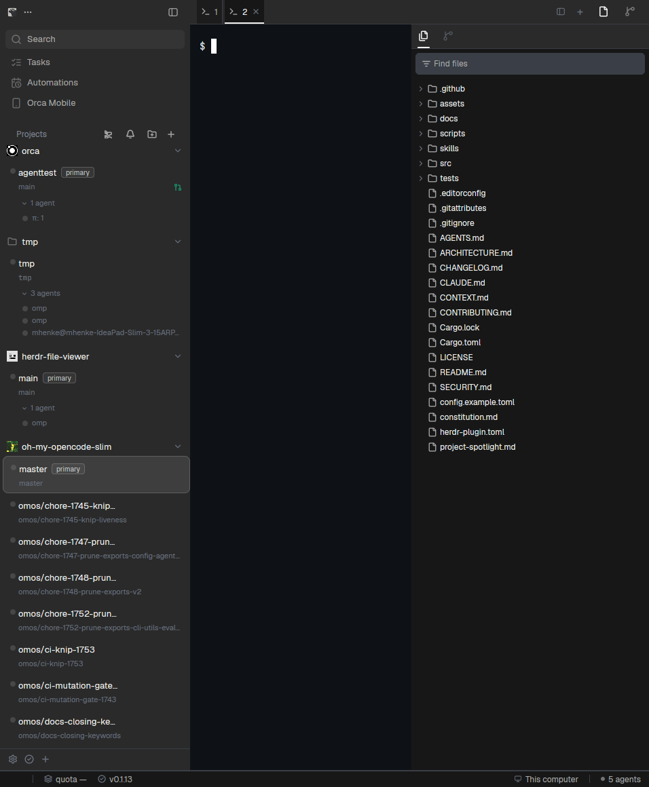

# Herdr Orca

An [Orca](https://github.com/stablyai/orca)-like workspace layout for [Herdr App](https://herdr.dev): Orca's distinctive three columns, collapsible project worktree hierarchy, activity rail, flat tabs, file explorer, Git changes inspector, and full-span status bar.



## Philosophy

**Keep the workspace where your hand expects it.**

Orca's shape is one cohesive window: a project list on the left, the work in the middle, the repository on the right, and a unified status bar along the bottom. Herdr draws that entire shape natively without forking it, combining the layout definition with focused mods for each panel.

Every figure and measurement was read directly from Orca's renderer source code, not estimated from screenshots. Full specifications and source citations are detailed in [RECIPE.md](RECIPE.md).

## Features & Component Architecture

The layout coordinates 16 self-contained mods under `mods/`:

- **Three columns at Orca's widths**: left sidebar 280px (min 220, max 500), right panel 350px (min 220, max 900), 1px dividers, square pane corners (radius 0). The center reads flat, as Orca's does.
- **Project cards in the sidebar (`orca-spaces`)**:
  - Repositories organize into collapsible groups with folder glyphs.
  - Worktrees render as cards carrying branch identities, with `primary` badges on main checkouts.
  - Linked worktrees nest under their checkout with Orca-accurate 18px indentation.
  - Main checkout auto-discovery: even when a repository is opened only on linked worktrees, the main checkout is discovered and shown as the canonical header.
  - Sidebar scrollbar sits in Orca's dedicated gutter to preserve card pitch.
  - Concurrent Git discovery (`Promise.allSettled`) with an authentic "Loading workspaces…" indicator.
  - Saved custom project folders persist across restarts in `localStorage`.
- **Live agent status rollup**:
  - Real-time rollup across cards, tabs, and the status bar using Herdr's 4 priority states (`working`, `blocked`, `done`, `idle`).
  - Displays turning spinners (`working`), red alert glyphs (`blocked`), or green checkmarks (`done`).
- **Activity rail & right utility panel (`orca-panel-head`)**:
  - 36px activity bar header with 16px icons.
  - **Files Explorer (`orca-files`)**: full-bleed tree with 30+ language file icons, Names/Contents search switch, and debounced "Find files" filter input.
  - **Changes Inspector (`orca-changes`)**: partitioned staged/unstaged file lists, per-file diff inspection, section collapse, and inline commit message composer.
  - Secondary tool views (`orca-agents`, `orca-panel-gap`) for session vault and secondary tabs.
- **Flat tab strip (`orca-tabs`)**:
  - Full-bleed flat tabs with active 2px bottom underline indicator bars.
  - Program icons, close buttons (`×`), and tab color dots synchronized with the menu store.
  - Integrated sidebar collapse/expand toggle (`panel-left`) at the far left.
- **Terminal pane header (`orca-pane`)**:
  - Minimal 24px header revealing on hover with custom tab pane titles, split buttons (`pane.split:right`, `pane.split:down`), zoom toggle, and close.
- **Full-width status bar (`orca-status`)**:
  - 24px bar spanning the window bottom outside the body column.
  - Left: Git branch badge, dirty file counter, ahead/behind sync indicators.
  - Center: Aggregated agent turn execution status.
  - Right: Host machine count, update status indicator, and workspace connection state.
- **Create dropdown (`new-menu`)**:
  - 288px popover menu for launching agents (OpenCode, Antigravity, Claude Code, Codex), opening folders, or creating Git worktrees.
- **Context menus (`orca-menu`)**:
  - 208px / 176px context menus for worktrees, project headers, and tabs with full mouse and keyboard navigation (arrows, Enter, Space, Home, End, Esc), clipboard integration, and external file reveal.
- **Floating overlay (`orca-float` / `orca-pane-status`)**:
  - Bottom-right overlay supporting Orca's "New Terminal" and "Minimize" actions, plus running agent pills.
- **Orca's palettes**:
  - `orca-dark` (Ghostty Default Style Dark, Orca's default) and `orca-light` (Builtin Tango Light), plus Orca's greys for the chrome and panels.

## Installation & Distribution

### 1. Community Distribution
- **Full Layout**: Distributed via GitHub topic `herdr-layout` and indexed on [herdr.dev/layouts](https://herdr.dev/layouts).
- **Standalone Mods**: Individual mods from this package are also distributed as modular units at [mhenke/herdr-orca-mods](https://github.com/mhenke/herdr-orca-mods) and indexed on [herdr.dev/mods](https://herdr.dev/mods).

### 2. Manual Installation
Copy the package files into your Herdr configuration directory (`~/.config/herdr-app`):
- `layouts/orca.json` and `layouts/orca.svg` into `~/.config/herdr-app/layouts/`
- Every folder in `mods/` into `~/.config/herdr-app/mods/`
- Every theme in `extras/themes/*.json` into `~/.config/herdr-app/themes/`
- Merge `keys.json` into `~/.config/herdr-app/keys.json`

Or run the included sync script:

```sh
sh scripts/sync.sh
herdr-app do layout.switch '{"name":"orca"}'
```

Nothing requires an app restart: `layout.switch` live-swaps the layout in the running window, edited layout files auto-reload, and mods hot-reload on save.

How it looks, behaves, and every number's source: [RECIPE.md](RECIPE.md).

## Keys

Defined in the `layout:orca` section of `keys.json` — active whenever `layouts/orca.json` is displayed. `sync.sh` merges them into your existing key bindings:

| Key | Command | Does |
| --- | --- | --- |
| `ctrl-shift-b` | `layout.toggle:sidebar` | Shows or hides the left sidebar |
| `ctrl-shift-e` | `layout.toggle:panel` | Shows or hides the right utility panel |

Tabs, spaces, and panes retain Herdr's standard navigation shortcuts (`alt-1`…`alt-9` for spaces, `ctrl-1`…`ctrl-9` for tabs, `alt-h/j/k/l` to move focus between panes).

## Settings

Theme fonts and sounds belong to your environment; configure them in `~/.config/herdr-app/settings.json`:

```json
{
  "font": "Geist Mono",
  "ui_font": "Geist",
  "font_size": 14,
  "sounds": {
    "enabled": true,
    "done": "data/sounds/ding.mp3",
    "blocked": "data/sounds/two-tone.mp3"
  }
}
```

The notification sounds correspond to Orca's `resources/notification-sounds/` in [stablyai/orca](https://github.com/stablyai/orca); place `ding.mp3` and `two-tone.mp3` into `~/.config/herdr-app/data/sounds/`. Geist ships embedded with Herdr.

## Updating

Pull updates and re-sync:

```sh
git pull && sh scripts/sync.sh
```

`sync.sh` updates the layout, themes, and shipped mod folders while preserving your custom settings and personal key bindings outside `layout:orca`.

## What It Runs

- `orca-spaces`: runs read-only `git status`, `git rev-parse`, and `git worktree list --porcelain` to discover worktrees concurrently. Probes `gh` for pull request review numbers and caches results in `localStorage`.
- `orca-files`: watches workspace directories via `watchFolder` and provides file operations (create, rename, delete, reveal). Runs `rg --vimgrep` for file searches.
- `orca-changes`: runs Git status, diff, staging, and commit operations (`git status`, `git diff`, `git add`, `git restore`, `git commit`).
- `orca-status`: periodically checks local git branch and dirty status.
- `orca-menu`: clipboard integration (`wl-copy` / `xclip` / `pbcopy`) and system file reveals (`xdg-open` / `open` / `explorer.exe`).

All Git executions pass `--no-optional-locks -c core.fsmonitor=false` so locks are never held and file watches are not triggered in loops.

## Releases & Agent Release Skill

Releases adhere to [Semantic Versioning](https://semver.org/spec/v2.0.0.html) and [Keep a Changelog](https://keepachangelog.com/en/1.1.0/). Release notes and version history are maintained in [CHANGELOG.md](CHANGELOG.md) via [git-cliff](https://git-cliff.org) from Conventional Commits.

### Releasing via the `herdr-orca-release` Skill
When working with coding agents (such as Antigravity, Claude Code, or OpenCode), release workflows are governed by the specialized [`herdr-orca-release`](.agents/skills/herdr-orca-release/SKILL.md) skill. The skill guides pre-flight verification gates, SemVer determination, changelog previews, tag creation, and GitHub release publication.

### Releasing via CLI Script
You can also run the release automation directly:

```sh
# 1. Preview changes and changelog in dry-run mode
./scripts/release.sh --dry-run <version>

# 2. Run checks (node --check, herdr-app check), update CHANGELOG.md, commit and tag
./scripts/release.sh <version>

# 3. Cut release, push tag, and create GitHub Release with release assets (.tar.gz and .zip)
./scripts/release.sh <version> --push --github-release
```

Automated GitHub Actions (`.github/workflows/release.yml`) package distribution tarballs (`.tar.gz` and `.zip`) and attach them to the GitHub release upon tag push.

## Verification & Parity Testing

To ensure complete parity and guard against regressions:

```sh
# Run citation checks (validating citations against ~/Projects/orca), syntax, and mod checks
python3 scripts/verify.py

# Run with optional smoke test (restarts app and scans for runtime exceptions)
python3 scripts/verify.py --smoke
```

## Credits and License

- Architecture and styling ported from [stablyai/orca](https://github.com/stablyai/orca) (MIT License, Copyright Orca).
- Space models and avatars informed by [herdr-t3](https://github.com/JinJieBeWater/herdr-t3) (Apache-2.0).
- Shipped under the Apache-2.0 License, matching Herdr App.
