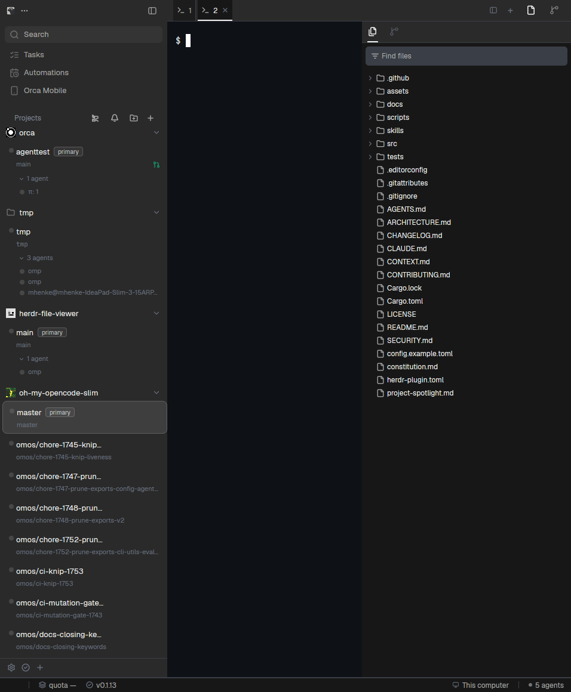

# Herdr Orca

An Orca-like workspace for Herdr App. It brings Orca's three-column layout straight into Herdr: a 280px left sidebar, a flat terminal work area, a 350px right utility panel, and a 24px status bar across the bottom. Projects organize into collapsible groups with worktree cards for your branches, live agent status marks, and primary checkout badges. Tabs sit flat with full-bleed active underline bars routing into Ghostty-dark terminal panes (or a clean landing view when you close your spaces), while the right activity bar switches between a full file explorer and your Git changes.

## What you see

Left to right, divider 1px `border` (`#2e2e2e`):

- **Sidebar** (280px wide, min 220, max 500; `chrome` `#2a2a2a` background; `ui-slice-agent-actions.ts:48`, `sidebar/index.tsx:47-48`), top to bottom:
  - **Brand bar** (36px tall, drags the window; `main.css:1086-1088` `titlebar-left`): Orca logo (16px at 75% opacity, margin `0 4px 0 10px`), followed by window drag region and 14px icon buttons (`p-4 rounded-4`; `TitlebarLeftControls.tsx`).
  - **Nav header** (168px tall; `SidebarNav.tsx:99-130+`):
    - Search: 28px tall button (`h-28 px-8 gap-8 rounded-6 bg-foreground/5`), 13px medium text at 60%, 16px search icon at 30% (`SidebarNav.tsx:99-116`).
    - Navigation rows: full-width inside `px-2 pt-2 pb-1` container, `rounded-md px-2 py-1.5 text-[13px]`, inactive `foreground/60`, hover `foreground/8`. Rows: Search, Tasks, Automations, Orca Mobile with their respective 16px icons.
    - Projects header band (32px tall, `mt-2 h-8 px-2 gap-1.5`; `SidebarHeader.tsx:61-66`): section label `Projects` (`pl-2 pr-0.5 text-xs semibold muted/80`), followed by 24px action buttons with 14px icons at stroke 2.25: Activity bell toggle (`w-8`), Add Project (`folder-plus`), Collapse All toggle (`chevrons-up-down` / `chevrons-down-up`), and New Workspace (`plus`).
  - **Spaces & Project Groups** (flexible block, `weight: 1`):
    - Project group headers (28px tall, `h-7 w-full gap-1.5 pr-2`; `worktree-list/rows/SectionHeader.tsx:227-340`): 16px icon slot with folder glyph (`size-4 rounded-[4px]`, glyph `size-3.5`), `text-[13px] font-semibold leading-4` repository name, and a 20px collapse chevron (`size-3.5`, `-rotate-90` when collapsed) flush right.
    - Worktree cards (`workspace-card/surface/worktree-card-surface.tsx:56-70`): single-line 36px (`py-2`), `rounded-lg`, active wash `foreground/10` over the sidebar plus `foreground/18` border (`main.css:1514-1527`).
      - Status lane: legacy card style (`shrink-0 flex justify-center items-start pt-[2px]`, `experimentalNewWorktreeCardStyle: false`), holding `StatusIndicator`'s 12px box around an 8px dot or spinner.
      - Card title: 13px line with worktree or branch name. Single-line cards take 8px padding; multi-line cards with meta or agent rows take 5px/6px (`worktree-card-surface.tsx:67`).
      - Primary badge (`identity/worktree-card-header-items.tsx:193`): `h-[16px] px-1.5 text-[10px] font-medium rounded`, `text-foreground/70 border-foreground/20 bg-foreground/[0.06]`, positioned on the repo's main checkout.
      - Card meta: 11px line showing branch and ahead/behind counters. Nested cards add `SIDEBAR_TREE_INDENT` (18px) so the title aligns under the header label (`worktree-list/rows/indentation.ts`).
      - Review badge: PR number mark (`#<number>`) at the right end of the meta line.
      - Agent rows: sub-rows for each agent run under that worktree with 12px status mark and agent task label.
  - **Sidebar footer** (32px tall; `sidebar-footer`): Settings button and machine actions, 24px icon buttons with dim icons brightening on hover.

- **Work Column** (flexible area, `canvas` `#0a0a0a` background):
  - **Tabs strip** (36px tall, drags the window; `main.css:1072-1074` `titlebar`):
    - Sidebar toggle button: 24px icon button (`panel-left`) at the far left to collapse/expand the 280px sidebar.
    - Tabs (`SortableTab.tsx:214`): flat tabs, `h-full px-1.5 text-xs`, active `bg-tab-active` = `--card` `#171717`, inactive = `foreground` at 4% over the card (`drop-indicator.ts:15-22`).
    - Active indicator: full-width 2px underline at the bottom edge (`inset-x-0 bottom-0 h-[2px] bg-foreground`).
    - Tab content: 12px icon (terminal or running agent program), tab name, and a 16px hover close button (`close.svg`).
    - New tab button: 24px `+` button at the right end of the tab list.
  - **Work body** (flexible row):
    - **Main pane** (stack, active `main-terminals`):
      - Live terminal view (`#282c34`, Ghostty Default Style Dark; `terminal-themes/defaults.ts:6-12`), 14px horizontal and 12px vertical padding, square corners (radius 0).
      - Pane header: minimal 24px header revealing on hover (`reveal: "hover"`) with pane title, split right (`pane.split:right`), split down (`pane.split:down`), and close button.
      - Landing view (`orca-landing`): welcome screen rendered when all tabs/spaces are closed.
    - **Right utility panel** (350px wide, min 220, max 900; `surface` `#171717` background, 1px `border`; `startup-ui-hydration.ts:45`, `right-sidebar-width.ts:1`):
      - Activity bar header (36px tall; `right-sidebar-top-activity-bar.tsx:40`):
        - Activity buttons (`activity-bar-buttons.tsx:145-177`): `h-[36px] w-9` flat buttons, 16px icons. Inactive `muted-foreground/60` brightening on hover with no fill; active `foreground` plus `bottom-0 left-[25%] right-[25%] h-[2px] bg-foreground`.
        - Buttons: Files (`folder`), Vault (`agent-session-history`), Workspaces (`workflow`), PR Checks (`list-checks`), Changes (`git-diff`, visible only in Git worktrees via Orca's `gitOnly` rule), Checks (`plug`), Ports (`plug`).
        - Panel hide button at far right (`panel-right`).
      - Panel body stack:
        - Files explorer (`orca-files`): 32px filter input (`FileExplorerNameFilter.tsx:23`: `h-8 rounded-md border border-border bg-input/50 px-2`, 14px filter icon, placeholder "Find files", `text-xs`), followed by full-bleed directory tree rows (`FileExplorerRow.tsx:147-152`: `w-full gap-1 rounded-sm px-2 py-1 text-xs`, indent `depth * 16 + 8` px, per-extension file icons, git status rollup badges).
        - Changes panel (`orca-changes`): staged/unstaged file list, diff viewer rows, commit message composer, and commit button.
        - Vault panel (`orca-agents`): agent session history list.
        - Stubbed panels (`orca-panel-gap`): clean empty states for secondary tabs.

- **Status bar** (24px tall, `status` block outside `body`, spans the entire window width; `StatusBarSurface.tsx:121`):
  - Height 24px, `px-3 gap-4`, top border `border`, `text-xs`.
  - Left: Git branch badge, dirty file count, ahead/behind sync indicator.
  - Center: Agent rollup status indicator.
  - Right: Host machine count, update status indicator, and workspace connection state.

- **Floating workspace** (`float-workspace`, `edge: bottom`, `align: end`; `layouts/orca.json`):
  - Mod `orca-float`: Orca's `Mod+Alt+A` panel, toggled here by `ctrl-alt-a` →
    `orca-float.toggle` (`keys.json`). Opens a 920x560 panel (min 420x280, clamped to the
    viewport as `floating-terminal-panel-bounds.ts:89-97` does) at bottom-right, listing the
    live agent sessions; a row focuses its agent, `×` hides the panel.
  - Named divergence: Herdr cannot toggle a float's visibility by command (`layout.toggle`
    walks nodes, not floats) and a mod cannot host a terminal, so the panel floats agents
    rather than a tabbed terminal/browser/markdown workspace. See
    `docs/adr/0003-a-float-cannot-hold-a-toggleable-terminal.md`.

### Colour and theme tokens

Herdr serializes a resolved theme as one flat object mapping token names to `#rrggbb[aa]` hex strings (`settings.rs:301`). Tokens used across the layout and mods:

| Token | Hex (Dark) | Orca Source & Role |
| --- | --- | --- |
| `canvas` | `#0a0a0a` | `main.css:336` (`--background`), root window canvas |
| `chrome` | `#2a2a2a` | `main.css:384` (`--worktree-sidebar`), left sidebar surface |
| `surface` | `#171717` | `main.css:392` (`--sidebar`), right utility panel surface |
| `background` | `#282c34` | `terminal-themes/defaults.ts:6-12` (Ghostty Default Style Dark), terminal background |
| `border` | `#2e2e2e` | `main.css:346` (`--border`), column and divider borders |
| `foreground` | `#ffffff` | Primary text and active icon stroke |
| `muted` | `#8b8b8b` | Secondary text, inactive badges, file tree paths |
| `dim` | `#5c6370` | Inactive icons, subtle indicators |
| `selected` | `#333842` | Row active hover / selected fill |
| `hover` | `#ffffff14` | 8% white hover fill on dark rows |
| `working` | `#e5c07b` | Yellow/amber turning spinner for active agent turns |
| `blocked` | `#e06c75` | Red alert glyph for agents awaiting user input/permission |
| `done` | `#98c379` | Green checkmark for completed, unseen agent turns |
| `idle` | `#5c6370` | Neutral grey dot for inactive agents |

A missing token paints **magenta** (`hsla(0.83, 1.0, 0.5, 1.0)` by design; `settings.rs:654-655`).

## How it behaves

- **Agent Status Lifecycle**:
  - Herdr rolls agent status up into four states: `working`, `blocked`, `done`, `idle` (`herdr-app/src/model.rs:528-536`).
  - `working`: Card status lane shows an animated amber turning spinner (`spinner.svg`); tab icon shows a spinning mark; status bar displays active turn count.
  - `blocked`: Card status lane and tab icon display an alert mark (`alert-circle.svg` / red), indicating the agent is paused for user permission or approval.
  - `done`: Card status lane and tab icon show a green checkmark (`circle-check.svg`), indicating the agent finished its task and has not yet been reviewed.
  - `idle`: Card status lane shows a muted grey dot.
  - Rollup priority on worktree cards: `blocked` > `working` > `done` > `idle`. A card with three idle agents and one working agent shows `working`.

- **Sidebar & Project Navigation**:
  - Clicking a worktree card selects that workspace (`space.select`). If the worktree has no open Herdr space, clicking opens a space at that folder (`space.new {folder}`).
  - Double-clicking a card initiates space rename.
  - Right-clicking a card opens the 208px context menu (`mods/orca-menu/main.js`): Rename, Copy Path, Copy Worktree Name, Open in Terminal (`terminal.open {folder}`), New Worktree, Remove Worktree, Close Space.
  - Right-clicking a project header opens the 176px project menu: New Workspace, Open Folder, Remove Project.
  - Clicking the Collapse All button (`ProjectsCollapseAllButton.tsx:51`) toggles folding across all project groups: glyph alternates between `chevrons-up-down` and `chevrons-down-up`.
  - Clicking an individual project header toggles fold state for that repository.
  - Clicking Search opens Herdr's workspace command palette (`openOverlay` with `palette`).
  - Clicking `+` in the projects header opens the 288px `new-menu` dropdown: New Terminal, New File Browser, New Terminal in Folder…, New worktree…, Open worktree…, then Start an agent — every installed agent, plus the first two this machine could install. An agent with a model list opens that list in place (Esc goes back); a model row launches with the agent's own flag (`--model`, or `-m` for Codex, Gemini and Grok), and Default launches with none.

- **Tabs Interaction**:
  - Clicking a tab selects it (`tab.select`).
  - Double-clicking a tab renames it.
  - Clicking `×` on a tab closes it (`tab.close`). Middle-clicking a tab also closes it.
  - Right-clicking a tab opens the 208px tab context menu (`SortableTabContextMenu.tsx:155`): Split Right (`pane.split:right`), Split Down (`pane.split:down`), Copy Tab ID, Close (`tab.close`), Close Others.
  - Clicking the sidebar toggle button (`panel-left`) collapses or expands the 280px sidebar without resetting tab state.
  - Clicking `+` at the end of the tabs strip opens a new terminal tab (`tab.new`).

- **Work Area & Panes**:
  - Hovering a terminal reveals the 24px floating pane header (`mods/orca-pane/main.js`) with terminal title, split buttons (`pane.split`), zoom toggle (`pane.zoom`), and close button (`pane.close`).
  - When all tabs and spaces are closed, the center area switches to `orca-landing` with quick start actions.

- **Right Utility Panel Interaction**:
  - Clicking any activity button in the 36px header switches the active stack child (`files`, `changes`, `vault`, etc.).
  - Clicking the active activity button or the panel-right close button toggles the entire 350px panel between visible and hidden.
  - Files explorer: clicking a folder row toggles expansion; clicking a file opens it; the Names filter debounces and narrows the tree; Contents searches file text with match-case, whole-word, regex and include/exclude globs; the tree renders through `v_virtual_list`, so only the visible rows are built each frame.
  - Changes explorer: clicking files stages or unstages them (`git add` / `git restore --staged`); typing into the composer and clicking commit runs `git commit -m`.

- **Keyboard Navigation**:
  - Configured in `keys.json` under `layout:orca`.
  - Context menus support keyboard navigation: Up/Down arrows to move selection, Enter or Space to invoke, Home/End for first/last row, Escape to dismiss.

## Built from

- `layouts/orca.json` node tree:
  - Root `column`, `titlebar: "none"`, `traffic_lights: [12, 16]`, `background: "canvas"`, `theme: "orca-dark"`, `divider: { width: 1, color: "border" }`.
  - `body` row with `floating: [{ id: "float-workspace", content: { mod: "orca-float" }, edge: "bottom", align: "end" }]`:
    - `sidebar` column (`px: 280`, min 220, max 500, `background: "chrome"`):
      - `brand` block (`px: 36`, `window_drag: true`, mod: `orca-chrome`).
      - `nav` column: `nav-top` (`px: 168`, mod: `orca-nav`), `spaces` (`weight: 1`, mod: `orca-spaces`).
      - `sidebar-footer` block (`px: 32`, mod: `orca-chrome`, props: `{ "footer": true }`).
    - `work` column:
      - `tabs` block (`px: 36`, `window_drag: true`, mod: `orca-tabs`).
      - `work-body` row:
        - `main` stack (`active: "main-terminals"`): `main-terminals` (`tab: "active"`, pane header: `orca-pane`), `main-landing` (`orca-landing`).
        - `panel` column (`px: 350`, min 220, max 900, `background: "surface"`):
          - `panel-head` (`px: 36`, mod: `orca-panel-head`).
          - `panel-body` stack (`active: "files"`): `files` (`orca-files`), `vault` (`orca-agents`), `workspaces` (`orca-panel-gap`), `pr-checks` (`orca-panel-gap`), `changes` (`orca-changes`), `checks` (`orca-panel-gap`), `ports` (`orca-panel-gap`).
  - `status` block (`px: 24`, mod: `orca-status`).

- **Mods**:
  - `mods/orca-chrome`: Window drag, Orca logo, and sidebar footer controls.
  - `mods/orca-nav`: Search launcher button and top navigation items.
  - `mods/orca-spaces`: Project section headers, worktree cards, primary badge, status rollups, collapse all.
  - `mods/orca-tabs`: Flat tabs strip with 2px underline indicator and sidebar toggle.
  - `mods/orca-pane`: Minimal 24px hover terminal header with split controls.
  - `mods/orca-landing`: Clean landing page when no spaces/terminals are open.
  - `mods/orca-panel-head`: 36px activity bar header for switching right panel tools.
  - `mods/orca-files`: File explorer tree with file-type icons, git badges, a name filter, and a contents search with its own search options.
  - `mods/orca-changes`: Git diff review, staging list, and commit message composer.
  - `mods/orca-agents`: Agent session history list.
  - `mods/orca-panel-gap`: Clean placeholder views for unopened secondary tabs.
  - `mods/orca-status`: 24px bottom status bar spanning the full window width.
  - `mods/orca-menu`: 208px / 176px context menu overlay for cards, spaces, and tabs.
  - `mods/new-menu`: 288px create dropdown overlay for creating terminals and worktrees.
  - `mods/orca-float`: Bottom-right floating workspace panel (`ctrl-alt-a`) listing live agent
    sessions; named divergence documented in
    `docs/adr/0003-a-float-cannot-hold-a-toggleable-terminal.md`.
  - `mods/orca-pane-status`: Pane-footer agent state mark, hard right (16px pane header).

- **Herdr commands & APIs**:
  - Navigation & spaces: `layout.switch`, `layout.resize`, `space.select`, `space.new`, `space.rename`, `space.close`.
  - Tabs & panes: `tab.select`, `tab.new`, `tab.close`, `pane.focus`, `pane.split`, `pane.close`, `pane.zoom`.
  - Terminals & agents: `agent.focus`, `terminal.open`, `terminal.copy`, `terminal.paste`.
  - Overlays & system: `openOverlay`, `closeOverlay`, `notify`, `exec`, `readTextFile`, `writeTextFile`, `watchFolder`.

- **External programs executed**:
  - `git worktree list --porcelain`, `git status --porcelain=v1`, `git rev-parse --show-toplevel --git-common-dir`, `git branch --show-current`, `git diff`, `git add`, `git commit`. All git invocations pass `--no-optional-locks -c core.fsmonitor=false`.
  - `gh pr view` / read-only cached GitHub REST checks via background worker.

- **Art & assets**:
  - Lucide SVG icons in each mod folder (at stroke 2.25 and 1.75).
  - Preview vector `layouts/orca.svg` and raster screenshot `preview.png`.
  - Theme files: `extras/themes/orca-dark.json` and `extras/themes/orca-light.json`.

## Watch out

- **Status bar layout**: The `status` block must sit *outside* `body` as a direct child of `root`. Placing it inside `body` cuts it off at the sidebar edge; Orca renders the status bar in `AppRootSurfaces`, spanning the whole screen width (`AppRootSurfaces.tsx:183`).
- **Node size schema**: Sizes must be specified as `"size": { "px": 36 }` or `"size": { "weight": 1 }` (`layout.rs:81-84`). A bare `"px": 36` on a layout node is silently ignored and causes the block to collapse to content size.
- **Context lifetime (`cx`)**: GPUI-kit contexts live only during the callback that delivered them (`scope.rs:419-422`). Never store `this.cx = cx` or capture `cx` across `setTimeout` / `setInterval`. Use `cx.timer.after`, `cx.timer.every`, or `cx.spawn`, taking `cx` directly from the callback arguments. Captured contexts trigger a render failure that paints an orange bar across the pane.
- **Mod isolation**: Herdr mods cannot resolve assets outside their own directory. `svg()` and `image()` resolve relative to `appHome/mods/<mod>/`. Every mod must carry its own local copies of required SVGs.
- **Worktree identity**: `isMainWorktree` is positional, not nominal (`!linked`, determined by checking whether the worktree directory matches the git common dir; `parseWorktreeList`). Exactly one primary badge exists per repository. Cards must be keyed by worktree path (`JSON.stringify([machine, worktreePath])`), not by Herdr space ID, because multiple spaces can target the same worktree.
- **Git locking & file watch**: Always pass `--no-optional-locks -c core.fsmonitor=false` on every Git command. Touching `.git/index` wakes Herdr's folder watcher in an infinite loop.
- **Async caching**: `setShared` updates shared storage but does not trigger reactive notifications; prefer module-scoped memory caches paired with `cx.notify()`.
- **PR review lookups**: Never query `gh` synchronously during render. The reader reads from `localStorage` cached data; a background worker updates the cache periodically.
- **Deliberate omissions**:
  - Checks panel: omitted pending dedicated GitHub workflow mod.
  - Dialog frames: Herdr draws overlay frames natively; mods suppress with `frame: "none"` but cannot restyle the window borders.
  - Worktree pin/unpin: Herdr's `terminal.pin` pins a terminal, not a worktree.
  - Mobile remote sync and cloud VMs: Orca-specific cloud infrastructure has no counterpart in Herdr.

## Done when

- `herdr-app check` passes on all `mods/orca-*` and `mods/new-menu`.
- `python3 scripts/verify.py` passes with 0 citation errors, syntax ok, and 0 missing assets.
- `layout.switch {"name": "orca"}` loads cleanly in Herdr App with no error banner or blank panes.
- Three columns render at 280px (sidebar), flexible center (work), and 350px (panel), with 24px status bar spanning the full window bottom.
- Project groups render folder headers, collapse/expand all toggles worktree lists, and main checkouts display the `primary` badge.
- Worktree cards show rolled-up agent status marks (`working`, `blocked`, `done`, `idle`).
- Tabs render flat with full-bleed 2px active bottom underline indicator and working sidebar toggle button.
- Right utility panel activity bar switches between Files tree and Changes git staging.
- Space and tab right-click context menus open at proper widths with working keyboard and mouse actions.
